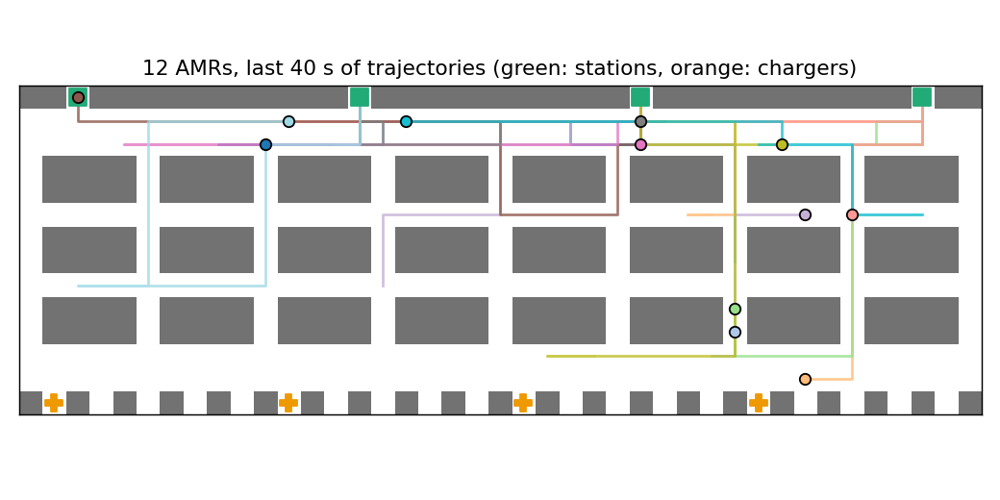
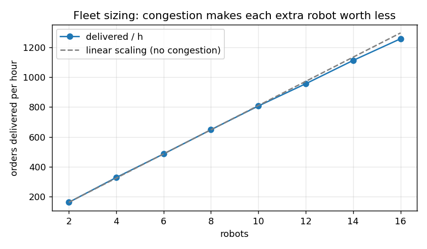

# amr-fleet-manager

A fleet manager for **autonomous mobile robots (AMRs) in a warehouse**. It handles:
- **task allocation** (FIFO, greedy, Hungarian)
- collision-free **multi-agent path finding** (space-time A* with a reservation table)
- **battery and charger management**
- KPIs, an independent collision audit, and a small HTTP API a WMS could call

It is built to answer the questions an operations or engineering lead actually has:
- How many robots should we buy?
- Which dispatch rule should we use?
- When should robots charge?



## How it works

| Layer | Approach |
|---|---|
| Layout | Shelf blocks with one-cell aisles and cross-aisles, pick faces on every shelf edge, drop stations cut into the front wall, and **dead-end** parking and charging bays at the back, so no robot ever has to pass through another robot's bay. |
| Allocation | Every second, available robots are matched to waiting orders. **FIFO** gives the oldest order the nearest robot; **greedy** takes the closest pair first; **Hungarian** minimises total empty travel over the batch (`scipy.optimize.linear_sum_assignment`). Orders waiting over 5 minutes jump the queue under every policy, so nothing starves. |
| Path finding | A robot's whole itinerary (to pick face, load, to station, unload, back to its bay) is planned in one go with **space-time A*** (exact BFS heuristic) against a shared **reservation table** of vertices and edges, then reserved. Parking is only allowed after the last time anyone else is scheduled through that cell. Robots returning to their bay can be re-tasked mid-route by replanning from their current position. |
| Safety check | `check_conflicts` replays the *executed* trajectories and flags any vertex collision or head-on swap. It is run after every simulation in the tests and benchmarks: **0 conflicts** across all runs below. |
| Energy | Drain per moving or idle second; robots below a threshold go to the nearest free charger. A task is refused if completing it would leave the robot below a reserve. Optional **opportunistic top-ups** while the queue is empty. Each charging session pays a docking overhead (30 s). |
| API | `GET /robots`, `GET /kpis`, `POST /orders` (standard library HTTP server; the simulation runs in a background thread). |

## Results

```bash
pip install -e ".[dev]"
python examples/benchmark.py   # ~3.5 min; writes docs/scaling.png and docs/warehouse.png
pytest
```

**Fleet sizing.** Demand is saturating at 2,160 orders/h; the warehouse is 41 × 14 cells with 128 pick faces.

| robots | delivered / h | per robot / h |
|---:|---:|---:|
| 2 | 162 | 81.0 |
| 8 | 648 | 81.0 |
| 12 | 956 | 79.7 |
| 16 | 1,257 | 78.6 |



With cross-aisles every five columns, congestion costs only about 3% of per-robot productivity at 16 robots. The cost shows up first in planning: the number of times a robot found no conflict-free route and had to retry grows from 12 to 617 per hour. That counter is the early-warning signal that the layout, not the fleet size, will become the bottleneck.

**Dispatch policy.** 12 robots, 790 orders/h, 3 seeds:

| policy | mean cycle | p95 cycle | queue wait | empty travel to pick |
|---|---:|---:|---:|---:|
| FIFO + nearest robot | 64.5 s | 115.3 s | 17.5 s | 16.8 m |
| greedy closest pair | 49.4 s | 86.2 s | 6.4 s | 13.0 m |
| **Hungarian** | **48.7 s** | **81.6 s** | **6.0 s** | **12.7 m** |

Optimal batch assignment cuts p95 order cycle time by **29%** against FIFO, purely by sending the right robot. Greedy gets most of the way there.

**Charging policy.** 12 robots, 720 orders/h, 4 h, 4 chargers, 2 seeds:

| policy | mean cycle | p95 cycle | sessions | min battery |
|---|---:|---:|---:|---:|
| charge below 15% | 141.9 s | 425.0 s | 80 | 8.1% |
| charge below 25% | 125.3 s | 408.9 s | 92 | 18.3% |
| charge below 40% | 89.7 s | 260.1 s | 116 | 33.5% |
| **charge below 15% + top up when idle** | **64.6 s** | **121.0 s** | 322 | 9.3% |
| charge below 25% + top up when idle | 71.9 s | 141.5 s | 340 | 17.5% |
| charge below 40% + top up when idle | 121.1 s | 232.3 s | 394 | 33.9% |

With threshold-only charging, robots tend to run low at the same time and **queue for the 4 chargers**, which shows up as p95 cycle times of about 7 minutes. Topping up whenever there is no work spreads charging into idle time and cuts p95 from 425 s to **121 s** (−72%) at the same low threshold. The cost is about 4× more charging sessions; check that against your battery chemistry's cycle-life rating. A high threshold *combined* with top-ups sends robots to charge too often and loses the benefit.

## API

```python
from fleet import Config, FleetSim, make_warehouse
from fleet.api import FleetService, make_server

service = FleetService(FleetSim(make_warehouse(), Config(n_robots=8, task_rate=0)), speed=50).start()
make_server(service, port=8080).serve_forever()
# curl -X POST localhost:8080/orders -d '{"pickup": [2, 3], "drop": [0, 2]}'
# curl localhost:8080/robots ; curl localhost:8080/kpis
```

## Limits and next steps

- Prioritised planning is fast but incomplete. It can fail to find a route that exists, which the "plan retries" counter makes visible. Conflict-Based Search or rolling-horizon replanning would close the gap for dense fleets.
- Robots move one cell per second on a grid; real AMRs need kinematic constraints, acceleration, and safety-field footprints. The reservation table is where those would plug in, as larger swept cells.
- The order interface is deliberately minimal. A production integration would map to VDA 5050-style orders and states.

## License

MIT
